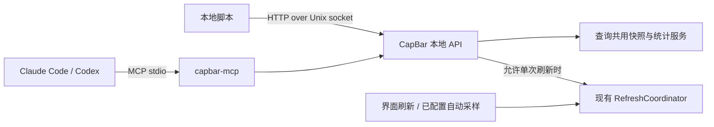

# CapBar 外部只读接口与单次刷新方案

状态：**方案已确认；实现完成后进行本地验收，不提前合并发布**
修订日期：2026-10-24
基于：CapBar 0.2.2
接口版本：`v1`

## 1. 功能边界

外部能力只分两类：

1. **只读查询**：账号列表、当前额度、采集时间、刷新状态、走势、用量统计、历史纪录。
2. **可选单次刷新**：相当于点击一次账号刷新或全部刷新；本次执行结束即结束。

外部不能设置定时刷新、开启自动采样、修改采样间隔、修改任何配置、增删账号、修改订阅校准、修改历史数据、管理权限、退出或启动 CapBar。

**查询不发起会话。单次刷新不创建定时任务，不改变现有自动采样配置。**

本次修订取消上一版的客户端管理、账号白名单、细分 scope、身份读取开关、外部刷新间隔配置和授权子集统计。所有外部调用使用一致的权限与口径。

## 2. 用户设置：只保留两个开关

| 配置项 | 默认值 | 效果 |
|---|---|---|
| 启用外部访问 | 关闭 | 开启后，MCP 和本地接口可只读查询全部已配置账号与已有统计 |
| 允许外部单次刷新 | 关闭 | 开启后，额外允许发起单个账号、某服务全部账号或全部账号的一次刷新 |

第二个开关仅在第一个开启时可操作。配置结构：

```json
{
  "external_access": {
    "enabled": false,
    "allow_one_shot_refresh": false
  }
}
```

设置页只增加“复制 MCP 配置”“复制本地接入信息”“重置访问密钥”三个操作，不增加其他配置项。

提示文案：

- 外部访问：“允许本机工具读取账号身份、额度和已有用量统计。”
- 单次刷新：“允许本机工具发起一次额度探测，可能消耗少量 token；不会开启定时采样。”

读取范围与 CapBar 中的账号列表一致，包括邮箱、组织、订阅档位及已有统计；不另设匿名模式或按客户端授权。密钥仅供用户信任的本地程序使用。

## 3. 接入结构



- 本地接口使用 HTTP/JSON over Unix Domain Socket，不开放 TCP 或局域网端口。
- socket 默认 `/tmp/capbar-<uid>/api.sock`；目录 0700、socket 0600，校验所有者、符号链接与连接者 UID。
- App 内提供唯一服务实例。MCP 是接入桥接器，不单独维护账号、快照、数据库或采样器。
- 安装包内包含原生 `capbar-mcp`，无需另外安装 Node.js/Python。
- App 未运行或外部访问关闭时，调用明确返回不可用；外部调用不自动启动 App。
- MCP 客户端断开不终止已受理的单次刷新；App 退出则按现有退出逻辑终止运行中的任务。

MCP 配置示意：

```json
{
  "mcpServers": {
    "capbar": {
      "command": "/Applications/CapBar.app/Contents/MacOS/capbar-mcp"
    }
  }
}
```

桥接器自动定位当前用户的 socket 和凭据，不需要 client ID 或账号授权配置。stdout 只输出 MCP 消息，诊断写 stderr。

## 4. 权限控制：全局只读，刷新单独控制

### 4.1 权限表

| 操作 | 外部访问关闭 | 外部访问开启、刷新关闭 | 两者开启 |
|---|---|---|---|
| 账号、额度、走势、统计查询 | 不可用 | 允许 | 允许 |
| 查询本次运行的刷新任务状态 | 不可用 | 允许 | 允许 |
| 发起单次刷新 | 不可用 | 拒绝 | 允许 |
| 定时任务、设置、账号管理、数据修改 | 不开放 | 不开放 | 不开放 |

只读接口可以触发已有样本的派生统计计算/缓存更新，但不能采集新额度或更改原始历史。

### 4.2 简化认证

- 首次启用时自动生成一个本机访问密钥。所有接口验证该密钥，不提供匿名访问。
- MCP 自动从当前用户的私有凭据文件读取；本地脚本使用 Authorization Bearer 头。
- 密钥和供 curl 使用的 header 文件位于 `~/Library/Application Support/CapBar/ExternalAccess/`，目录 0700、文件 0600；不进入仓库、日志或 MCP 配置文本。
- “重置访问密钥”使旧密钥立即失效。所有接入程序共用这一授权，不提供每客户端管理。
- 不输出服务商 OAuth 令牌、钥匙串内容、账号目录或原始 CLI 日志。
- HTTP Host 固定为 capbar.local；拒绝 Origin 请求，不启用 CORS。
- 同一 macOS 用户下拥有任意文件读取权限的程序可能读取密钥；这不是同用户恶意进程隔离沙箱。

关闭外部刷新时，已开始的探测完成，尚未开始的外部排队任务跳过；UI/自动采样已经开始的共享探测不受影响。关闭外部访问同时停止监听，效果相同。重新开启不重放任务。

## 5. 通用数据约定

- 所有时间戳使用 RFC3339 UTC；本地日期另外返回日期字段和 IANA 时区。
- `captured_at` 是采集时间，`generated_at` 是响应生成时间，不能混用。
- 区间为 `[starts_at, ends_at)`。
- 剩余额度是 0–100%；区间使用量或累计使用量可以超过 100%，不截断。
- null 表示未知或缺测；0 表示实际零用量，或历史合计明确按“缺测计零”规则计算。
- 对外账号使用持久化随机 `account_id`，不暴露本地目录；排序沿用 App 配置顺序。
- account_id 代表配置账号槽位，不保证同一目录更换登录后仍是同一订阅人。移除后旧 ID 不可查询；重新添加的 ID 处理在迁移测试中固定。
- 数据结构复用同一份 DTO/JSON Schema，MCP 与本地接口不维护两套算法。

响应包装：

```json
{
  "api_version": "v1",
  "request_id": "req_example",
  "generated_at": "2026-10-24T08:00:00Z",
  "data": {},
  "warnings": []
}
```

成功用 HTTP 200，未完成刷新用 202。MCP 返回相同 data，并提供结构化结果。

## 6. 接口清单

| MCP 工具 | 本地路由 | 类型 |
|---|---|---|
| `capbar_get_status` | GET `/v1/status` | 只读 |
| `capbar_list_accounts` | GET `/v1/accounts` | 只读 |
| `capbar_get_quotas` | POST `/v1/quotas/query` | 只读 |
| `capbar_get_usage` | POST `/v1/usage/query` | 只读 |
| `capbar_get_statistics` | POST `/v1/statistics/query` | 只读 |
| `capbar_get_records` | POST `/v1/records/query` | 只读 |
| `capbar_refresh_once` | POST `/v1/refresh-jobs` | 可选单次刷新 |
| `capbar_get_refresh_status` | GET `/v1/refresh-jobs/{job_id}` | 只读 |

POST 查询只是为了传递 JSON 参数，不表示修改数据。未开启单次刷新时，不向 MCP 展示 refresh_once 工具；即使直接构造请求，服务端也会拒绝。

### 6.1 服务状态

get_status 输入 `{}`，返回：

```json
{
  "app_version": "0.2.2",
  "instance_id": "instance_example",
  "account_count": 3,
  "one_shot_refresh_allowed": false,
  "statistics_enabled": true,
  "sampling_interval_hours": 4,
  "plot_interval_hours": 4,
  "time_zone": "Asia/Shanghai"
}
```

采样设置在这里只供查询，不能修改。instance_id 标识本次进程运行，用于识别重启后的任务失效。

### 6.2 账号列表

list_accounts 参数：`provider?: claude|codex`，不传返回全部。

返回 `accounts` 数组，每项：

| 字段 | 含义 |
|---|---|
| account_id | 稳定外部 ID |
| provider | claude / codex |
| email、organization | 已识别身份，未知为 null |
| plan | `{tier,display_name,source}`，source=detected/manual/unknown |
| has_snapshot | 是否已有快照 |
| refresh_state | idle / queued / running / retry_wait |

不存在“可用账号”猜测：最近刷新失败通过额度结果的 last_error 表达，不推断账号永久不可用。

### 6.3 额度查询

get_quotas 输入 `selector`，必填且只能选择一种：

```json
{"selector":{"account_ids":["acc_example"]}}
```

```json
{"selector":{"provider":"claude"}}
```

```json
{"selector":{"all":true}}
```

返回 `accounts` 数组，每项示意：

```json
{
  "account_id":"acc_example",
  "provider":"claude",
  "captured_at":"2026-10-24T07:40:00Z",
  "age_seconds":1200,
  "last_attempt_at":"2026-10-24T07:40:00Z",
  "refresh_state":"idle",
  "last_error":null,
  "windows":[
    {"kind":"seven_day","remaining_percent":30,"used_percent":70,"resets_at":"2026-10-27T08:00:00Z"}
  ]
}
```

- 不增加新鲜度阈值参数，由调用方根据采集时间判断是否需要请求一次刷新。
- 没有快照时 captured_at/age_seconds 为 null，windows 为空。
- 只有七日窗口就只返回七日；重置时间未知为 null。
- 刷新中或失败时可以返回旧快照；last_error 为 `{code,message}`，没有错误为 null。
- used_percent 是当前周期累计比例，与趋势的区间使用量含义不同。

### 6.4 走势查询

get_usage 输入：`target` 必填，只能为 `{"account_id":"acc_example"}` 或 `{"provider":"claude"}`；`include_contributions?: boolean` 默认 false，仅 provider 目标有效。

首版固定查询与界面一致的滚动近七日，使用当前绘图间隔；不增加可修改采样频率、任意 SQL 或自定义算法参数。

返回：

- `target, availability`：available / no_history / calibration_required。
- `range: {starts_at,ends_at,time_zone,bin_hours}`。
- `unit`：account_weekly_quota_percent 或 baseline_weekly_quota_percent。
- `baseline`：总走势返回 `{account_id,plan_tier,capacity_factor,estimated:true}`；单账号为 null。
- `coverage: {valid_bins,expected_bins,first_sample_at,last_sample_at}`。
- `points`：按 ends_at 升序。

单账号 point：`{starts_at,ends_at,usage_percent,remaining_percent,crosses_reset,estimated}`。

总走势 point：`{starts_at,ends_at,usage_percent,observed_accounts,expected_accounts,estimated}`；需要分摊时额外返回 contributions 数组：`{account_id,raw_usage_percent,equivalent_usage_percent}`。

基准始终为 App 中该服务的第一个账号，套餐比例沿用现有估算模型。少数账号缺测不阻止其他账号求和；所有账号缺测则 usage_percent=null。缺少必要订阅校准时 availability=calibration_required，指出账号 ID，不猜系数。

### 6.5 近期统计查询

get_statistics 输入：`provider: claude|codex` 必填。返回与总走势相同的 range、baseline、coverage，加：

| 字段 | 含义 |
|---|---|
| observed_total_percent | 七日有效区间用量合计 |
| maximum | `{usage_percent,starts_at,ends_at}` 或 null |
| minimum_percent | 有效区间最低，不把走势缺测当零 |
| average_percent | 有效区间平均 |
| leading_account | `{account_id,equivalent_usage_percent,share_percent}` 或 null |
| high_usage_period、low_usage_period | `{start_hour,end_hour,time_zone,estimated}` 或 null |
| usage_periods_uniform | 时段是否无明显高低差别 |
| recent_24_hours、previous_24_hours | `{usage_percent,valid_bins,expected_bins}` |
| change_percent | 24 小时相对变化率，保持现有覆盖要求与零基数规则 |
| latest_observed_interval | 最近有观测区间 `{starts_at,ends_at,usage_percent}` 或 null |

使用量、等效使用量、环比增长率分别标明，不能混淆。无历史时 availability=no_history，数值为 null。

### 6.6 历史纪录查询

get_records 输入：`provider: claude|codex` 必填。返回 baseline、time_zone、first_sample_at、completed_before，以及：

- highest_seven_days：历史最高连续七日本地自然日用量。
- lowest_seven_days：历史最低连续七日本地自然日用量。
- highest_day：历史最高已结束自然日用量。
- highest_interval：历史最高已观测区间用量。

每项为 `{usage_percent,starts_at,ends_at,start_date,end_date_inclusive}` 或 null。

保持已确认的规则：日/七日合计允许缺测并按 0 计算；从首次采样日期开始，满七个已结束自然日才有七日纪录；当天不纳入日/七日纪录。走势图缺测仍为 null。

关闭统计后仍可读取已保存历史，不恢复采样。结果可带 collection_enabled=false，提醒调用方当前没有自动采集。

## 7. 单次刷新：仅执行这一次

### 7.1 refresh_once 参数

```json
{
  "selector":{"provider":"claude"},
  "instance_id":"instance_example",
  "request_key":"一次逻辑调用的UUID"
}
```

仅三个参数：

- selector：与额度查询相同，可选账号、服务商、全部。
- instance_id：先从 status 获取，防止 App 重启后旧请求自动重放。
- request_key：同一请求因网络中断重试时保持不变，避免重复探测。

没有 interval、cron、schedule、auto_refresh、repeat、提示词、模型或 force 参数。未知参数直接拒绝。

每次调用最多启动所选每个账号的一次刷新流程；已有流程内的失败重试沿用 CapBar 当前策略，不属于定时刷新。结束后不会再执行下一轮。

### 7.2 去重与返回

1. 检查外部访问和单次刷新开关、密钥及参数。
2. request_key 已存在且请求相同：返回原任务；不同内容复用同一键：409。
3. 同账号已有 UI/采样/API 刷新：加入该执行的等待，不启动新会话。
4. 其余账号启动本次刷新；数量过多时使用内部队列逐个执行，不循环调度。
5. 返回 job_id。调用方可查询进度；查询进度本身不触发刷新。

```json
{
  "job_id":"job_example",
  "state":"running",
  "items":[
    {"account_id":"acc_a","action":"started","state":"running","error":null},
    {"account_id":"acc_b","action":"joined","state":"running","error":null}
  ]
}
```

Job state：running / completed / partial_failure / failed / interrupted。

Item state：queued / running / retry_wait / succeeded / failed / skipped / interrupted；action 为 started / queued / joined。查询响应还包含 attempt、created_at、finished_at、captured_at（可空）及 history_write（pending/stored/not_requested/failed）。queued 的 action 代表受理方式，当前进度由 state 表达。

全部终态且无失败为 completed；全部失败为 failed；混合为 partial_failure；关闭 App 导致未完成为 interrupted。关闭刷新开关后的排队项为 skipped 并说明原因。

### 7.3 get_refresh_status

输入：`job_id` 必填，无其他配置。返回上述批次状态。客户端建议每 2 秒查询一次，任务终态后停止查询。

- 任务与 request_key 在本次进程内保留，终态后最多 24 小时；不增加任务数据库或恢复执行机制。
- 重启会更换 instance_id；旧刷新请求拒绝为 INSTANCE_CHANGED，旧任务查询返回 JOB_NOT_FOUND，明确可能已中断，应先读最新快照再决定是否重新刷新。
- 网络超时、MCP 断开不自动重新提交新 request_key，也不取消已开始的共享探测。
- API 不开放取消 UI/采样任务的能力。

### 7.4 保存行为

成功后更新最新 JSON。现有用量统计开启时，与 UI 手动刷新一样写入历史；统计关闭时，不因为外部刷新而开启统计或定时采样。

失败保留旧快照，返回错误。快照已保存但历史写入失败，标识 history_write=failed；不为了修补历史重复发起会话。

开启单次刷新表示允许外部主动调用。接口本身不提供定时执行；外部程序如果自行反复调用，仍是多次独立请求，CapBar 不能从一次请求判断外部程序是否由其自己的计时器触发。用户可关闭单次刷新许可；内部限流防止高频调用。

## 8. 内部保护，不增加用户配置

以下写入内部策略文件，用户无需设置：

- 沿用现有探测策略：最多 3 次尝试，每次 45 秒，重试随机等待 10–20 秒。
- 每账号全局只允许一个刷新执行，覆盖 UI、自动采样和外部调用。
- 外部新启动探测同时最多 2 个账号；每次最多 200 个账号，排队总上限 200；超过时整次请求拒绝，不静默丢项。
- 所有外部查询合计每分钟最多 120 次，瞬时突发 20 次；新刷新批次最多每分钟 6 次，瞬时突发 2 次。重复 request_key 不新增批次，但仍受总请求限流。
- 同时最多 5 个外部活动批次；终态任务与幂等记录最多保留 1000 个，且不超过 24 小时。容量占满时拒绝新的批次，保留尚未到期的幂等映射，不能提前淘汰后重新执行同一请求。
- 请求体最多 64 KiB；禁止任意文件路径、SQL、命令或提示词参数。
- 统计缓存继续使用当前样本修订、采样间隔、校准、账号顺序、算法版本、时区及本地日期，不增加每客户端统计缓存。
- 同一统计重算合并执行，不在主线程扫描历史；超过 5 秒返回 ANALYTICS_BUSY，后台计算继续，查询重试不触发探测。
- 日志不记录凭据、邮箱、目录或完整返回内容；仅保留限量本地诊断。

## 9. 错误约定

```json
{
  "api_version":"v1",
  "request_id":"req_example",
  "error":{
    "code":"REFRESH_DISABLED",
    "message":"未开启外部单次刷新",
    "retryable":false
  }
}
```

| 状态 | code | 说明 |
|---|---|---|
| 400 | INVALID_ARGUMENT | 无效参数，包括任何定时/配置参数 |
| 401 | UNAUTHENTICATED | 密钥无效 |
| 403 | REFRESH_DISABLED | 单次刷新开关关闭 |
| 404 | ACCOUNT_NOT_FOUND / JOB_NOT_FOUND | 账号/任务不可用 |
| 409 | IDEMPOTENCY_CONFLICT / INSTANCE_CHANGED | 重复键内容冲突 / 进程已更换 |
| 413 | REQUEST_TOO_LARGE | 请求过大 |
| 429 | RATE_LIMITED / QUEUE_FULL | 请求过密或队列已满，返回 retry_after_seconds |
| 503 | SERVICE_UNAVAILABLE / ANALYTICS_BUSY | 服务不可用 / 统计重算繁忙 |
| 500 | INTERNAL_ERROR | 脱敏内部错误 |

App 未运行时，由桥接器把 socket 错误映射为 SERVICE_UNAVAILABLE。MCP 业务错误使用 isError=true，附相同 error 对象；探测失败是任务结果，不把所有任务查询当作协议错误。

## 10. 确认后实施与验收

本节作为实施与本地验收清单；发布须另经用户确认。

开发顺序：

1. 共用只读应用服务、对外账号 ID 和 DTO；保持原有统计测试通过。
2. socket 服务与全局密钥，两个设置开关。
3. 单次刷新任务与已有协调器去重，先写并发、幂等和保存失败回归测试。
4. MCP 桥接器、配置复制与安装包集成。
5. 使用真实 Claude Code/Codex 验证只读查询、单次刷新及一致性。

必须验证：

- 所有只读工具的实际探测次数均为 0。
- 外部未获刷新许可时，无论 MCP 还是直接接口都不能探测。
- 单次刷新结束后不再执行，采样配置、账号配置和定时任务数量保持不变。
- 两个 Agent 与 UI 同时刷新同账号，只有一个真实会话。
- 同一个 request_key 重试不会新增探测；App 重启后旧请求不会重放。
- 关闭刷新开关会阻止外部排队项新启动，不取消正在运行的共享刷新。
- 所有设置修改、账号管理、定时参数请求都被拒绝。
- UI、MCP、本地接口在相同数据时刻返回同一统计结果。
- 关闭统计时，外部刷新不自动开启统计；已有历史仍能只读查询。
- 无凭据泄漏，无网络端口监听，安装包升级保留现有用户数据。

## 11. 已确认的范围

确认的整体方案：**两个开关、全部已配置账号可读、最多允许单次刷新，外部不开放任何设置或管理功能。**
