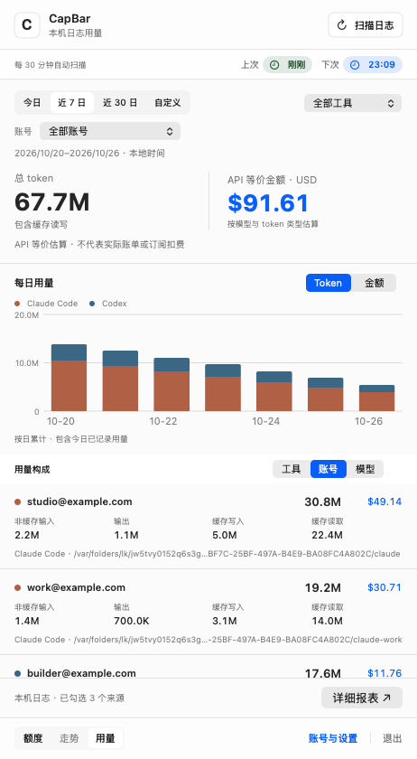
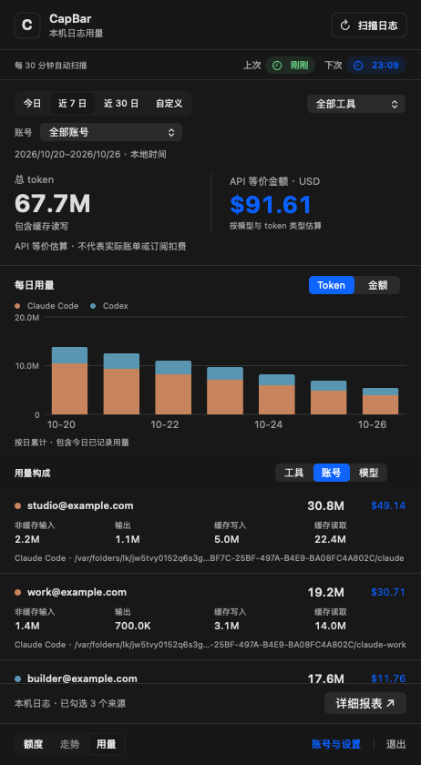

# Token 用量统计

CapBar 0.4.0 提供以下本机用量与详细报表功能。

「额度」「走势」「用量」是三个独立页面，共用全局弹窗尺寸。详细报表使用独立的非模态窗口，可缩放、最小化、单独关闭；不占用或改变主弹窗。

| 浅色原生用量页 | 深色原生用量页 |
| --- | --- |
|  |  |

示例使用虚构日志与账号。[悬浮气泡](images/token-usage-hover-light.png)、[深色气泡](images/token-usage-hover-dark.png)、[用量设置](images/token-usage-settings-usage.png)、[明细](images/token-usage-report.png)均由 SwiftUI 渲染。

## 使用

- 目录只在账号页配置一次，在「用量 → 日志来源」勾选。取消勾选不删除账号、不改变额度查询。
- 支持今日、近 7 日、近 30 日、自定义日期。包含首尾两日，按本地日历计算。
- 总量包含非缓存输入、输出、缓存写入、缓存读取；金额为 API 等价估算，不代表实际账单或订阅扣费。
- 点击「详细报表 ↗」打开独立窗口，默认 1680 × 1000 pt（适配屏幕可用区域），最小宽度 1000 pt；列宽可拖动，表头固定，支持横向与纵向滚动。
- 报表支持账号、工具、时间范围筛选，按日/月/账号/模型/工具分组；⌘F 搜索账号、模型、目录、日期，多词同时匹配，点击表头升降序排序。token 与金额按数值排序。
- 报表的筛选、搜索和排序独立于主窗口；搜索后卡片及底部合计只统计匹配记录。关闭后可再次打开，保留本次筛选状态；新扫描的数据会自动更新。
- 可筛选单个账号；下方汇总可切换工具、账号、模型，详细报表支持按账号分组。日志按已配置的目录归属账号，每个目录独立调用原样的 ccusage 核心。
- 悬浮柱状图在图表下方显示日期、各工具四类 token、金额、当日合计及各账号贡献条，随内容滚动，不遮挡图表。气泡里的总量和账号合计用 M，四类 token 明细仍为完整数字。Claude 陶土橙、Codex 灰蓝色；图表、图例和气泡统一，金额与操作沿用系统蓝色。
- 自动扫描默认每 30 分钟，可选 15/30/60/120 分钟或自定义 1–1440 分钟。关闭自动扫描仍可手动扫描；仅在应用运行时执行。
- 扫描时按钮显示真实的账号完成数和已用秒数，例如「账号 1/7 · 8秒」，不显示文件数量或内部阶段。
- 扫描按钮附近显示上次完成和下次计划。正常时间为绿色，超过一个扫描间隔为橙色，超过两个间隔为红色；手动模式灰色，下次计划蓝色。读取失败保留旧结果和时间。

## 核心直接复用 ccusage

应用内置从 [ccusage 20.0.44](https://github.com/ccusage/ccusage/tree/e351d846191a0176520e8b3d8151dd80a60bc7e4) 原始源码构建的原生引擎，运行时不依赖系统安装的 ccusage。原先自写的 Swift 日志解析、去重、解压与计价实现已移除。

| 职责 | 原样使用的上游代码 |
| --- | --- |
| 并行读取及按文件大小分配任务 | `Vendor/ccusage/rust/adapters/common/src/lib.rs` |
| Claude 筛选、去重、回放、iterations、每日模型汇总 | `Vendor/ccusage/rust/adapters/claude/src/` |
| Codex 压缩归档、累计增量、fork、compaction、模型识别及聚合 | `Vendor/ccusage/rust/adapters/codex/src/` |
| 模型别名、缓存、长上下文、speed、历史价格及缺失价格标记 | `Vendor/ccusage/rust/crates/ccusage-core/src/` |
| 离线价格及规则 | `Vendor/ccusage/rust/crates/ccusage-pricing-snapshots/` |

`UsageEngine/src/main.rs` 只传入目录、时区和离线计价参数，调用上游函数并序列化结果。Swift 只负责调度、持久化、日期筛选和渲染，不另行计价。无模型调用，无额外模型 token 消耗。

依照上游规则，不相关、损坏或不符合格式的记录直接跳过，不显示“部分记录未分析完成”。只对确实无法读取的来源或引擎失败显示错误。未知价格保留上游缺失价格标记，不冒充 $0；金额 `+` 表示另有未定价部分。

缓存 `~/Library/Application Support/CapBar/token-usage-cache.json` 仅保存每账号的每日/模型汇总，权限 0600，原子替换。启动时直接恢复汇总，扫描时调用上游引擎更新。首次升级会跳过旧的大型逐请求缓存，并在成功后替换。保留日志之外的历史无法恢复。

## 验证与构建

`swift run CapBarChecks` 运行原有功能与界面桥接、来源选择、缓存、时间范围、并发检查。`--render-token-usage` 渲染虚构数据的原生界面；`--filter TokenLiveTests` 只读验证真实选中目录，缓存放临时目录。

0.4.0 发布前验证：606 项原生检查、400 项上游测试通过，287 份上游文件与内置引擎/桥接源码的完整性校验通过。原生检查包括独立报表窗口、搜索与数值排序，以及非公历系统设置下的协议日期解析。

2026-10-26 按工具合并目录版本的基准验证（账号目录拆分后的新验证见下）：上游 Claude/Codex/core/common 原始测试共 400 项通过；与独立 ccusage CLI 对比，248 组已结束日期/模型的四类 token 无差异，金额绝对差为 0。排除仍在写入的当天，避免把输入变化误判成算法差异。CapBar 整轮扫描约 15.45 秒（旧实现约 188.94 秒），汇总缓存 145,978 字节，重启恢复约 0.0078 秒。耗时会随数据和机器负载变化。

源码来源、完整性核验、引擎重建见 [UsageEngine](../UsageEngine/README.md)。上游 287 份文件逐个 SHA-256 验证未改动；打包前核验引擎和桥接源码。第三方 MIT 许可及依赖声明随应用分发。

账号归属改造后，本机真实目录扫描约 7.99 秒，413 组账号/日期/模型汇总、0 个来源错误；缓存 211,724 字节，恢复约 0.0052 秒。新增同工具多账号目录归属、小计相加、单账号筛选和模型分组回归检查。
